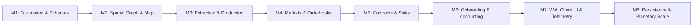

# Project Milestones and Implementation Plan

This document defines the delivery milestones for the **Planetary Economic Simulator**. Each milestone builds a playable vertical slice of the architecture specified in [[system-design-overview]].

---

## Roadmap Overview

---

## Milestone 1: Core Engine Foundation and Data Schemas

Build the deterministic tick runner, configuration loader, and shared TypeScript data models.

### Deliverables
- Implement the entity models and validation rules defined in [[data-schemas]].
- Load global simulation constants and tick intervals from [[configuration-and-parameters]].
- Build the in-memory state store and the player action queue in the NestJS backend.
- Implement the 7-phase tick runner skeleton defined in [[simulation-tick-loop]].
- Expose health check routes and the WebSocket tick broadcast channel from [[api-and-websocket-protocol]].

### Acceptance Criteria
- The server processes queued commands only at tick boundaries.
- The tick runner increments the tick counter and broadcasts a state delta over WebSockets.

---

## Milestone 2: Geography, Spatial Graph, and Freight Logistics

Construct the regional node graph and calculate deterministic shipping fees across routes.

### Deliverables
- Implement the node-and-edge graph model specified in [[spatial-graph-model]].
- Seed the starter territory nodes and route edges from [[starter-province-map]].
- Precompute the shortest-path distance matrix between all settlements.
- Implement the cargo weight and freight fee formulas from [[delivery-and-freight]].

### Acceptance Criteria
- The engine calculates exact freight fees for any commodity transfer between two nodes.
- Invalid or disconnected routes return a deterministic validation error.

---

## Milestone 3: Resource Extraction, Quality, and Production Chains

Enable facilities to extract raw materials, blend input quality, and manufacture goods.

### Deliverables
- Implement infinite primary commodity extraction with regional yield modifiers from [[resource-extraction]].
- Implement the quality grading scale ($Q \in [1, 100]$) and weighted blending math from [[quality-system]].
- Build the recipe batch processor and facility level scaling rules from [[transformation-chains]].
- Configure the three starter supply chains:
  - [[agriculture-chain]] (Grain, Flour, Bread).
  - [[forestry-chain]] (Timber, Planks, Furniture).
  - [[metallurgy-construction-chain]] (Iron Ore, Stone, Ingots, Bricks, Tools, Building Kits).

### Acceptance Criteria
- Phase 2 and Phase 3 of [[simulation-tick-loop]] consume inputs, apply quality blending, and output finished goods.
- Idle or input-starved facilities skip production without corrupting inventory state.

---

## Milestone 4: Spot Exchanges and Orderbook Matching

Enable price discovery and commodity trading at regional trade hubs.

### Deliverables
- Build the continuous double auction orderbook engine defined in [[spot-exchange-orderbooks]].
- Support limit buy orders, limit sell orders, and order cancellations in the action queue.
- Execute price-time priority matching during Tick Phase 4.
- Deduct market taxes and transfer funds and inventory atomically upon match execution.

### Acceptance Criteria
- Crossing bid and ask orders match at the resting order price during Tick Phase 4.
- Partial fills update remaining order quantities accurately.

---

## Milestone 5: B2B Contracts and Macroeconomic Sinks

Add recurring peer-to-peer supply agreements and automated demand sinks to close the economic loop.

### Deliverables
- Implement recurring supply agreements and fulfillment rules from [[b2b-contracts]] in Tick Phase 1.
- Implement the settlement retail utility function from [[settlement-consumer-demand]] in Tick Phase 5.
- Build the facility construction and upgrade material sink from [[capital-construction-sink]] in Tick Phase 6.

### Acceptance Criteria
- Settlements purchase consumer goods from local orderbooks based on price and quality utility.
- Facility upgrades consume Building Kits, Tools, Bricks, and Planks before increasing capacity.

---

## Milestone 6: Player Onboarding and Corporate Accounting

Implement franchise creation, financial statements, and insolvency handling.

### Deliverables
- Build the starter archetype selection flow (Agronomist, Forester, Industrialist) from [[onboarding-and-licenses]].
- Provision starter capital and level 1 facilities for new companies.
- Calculate balance sheets, net worth, and operating cash flow in Tick Phase 7 per [[company-management]].
- Enforce maintenance fee deductions and bankruptcy liquidation rules.

### Acceptance Criteria
- New players receive their archetype assets and can operate a profitable chain within their first session.
- Tick Phase 7 records accurate financial ledger entries for every company.

---

## Milestone 7: Web Client Dashboard and Telemetry UI

Build the React 19 and Material UI frontend following Atomic Design and the industrial telemetry theme.

### Deliverables
- Configure the Material UI theme tokens, color palette, and typography from [[ui-design-system]].
- Build atomic UI primitives (`atoms/`, `molecules/`, `organisms/`, `templates/`, `pages/`) and feature hooks in `web/src/libs/`.
- Render the interactive [[starter-province-map|Oakhaven Basin]] map with node status and freight routes.
- Build views for facility management, [[spot-exchange-orderbooks|market orderbooks]], [[b2b-contracts|contracts]], and [[company-management|financial statements]].
- Connect real-time WebSocket tick updates to selective client stores.

### Acceptance Criteria
- Players can inspect nodes, configure production recipes, place market orders, and track company net worth in the browser.
- Tick broadcasts update active UI views without full-page reloads.

---

## Milestone 8: Cloud Persistence and Planetary Scaling

Connect Firebase persistence, snapshot recovery, and multi-region worker partitioning.

### Deliverables
- Integrate Firebase Authentication and Firestore snapshot persistence as specified in [[system-design-overview]].
- Save periodic tick checkpoints to Firestore and restore in-memory simulation state on server startup.
- Partition regional graph clusters for parallel phase execution across worker threads.
- Run end-to-end load tests and macroeconomic balance verification across multi-day tick runs.

### Acceptance Criteria
- The server recovers full simulation state from the latest Firestore checkpoint after a restart.
- Tick execution latency remains within the target budget under concurrent player load.

---

## Related Notes
- [[index]] - Master Map of Content.
- [[system-design-overview]] - Full-stack simulation architecture.
- [[simulation-tick-loop]] - The 7-phase tick execution cycle.
